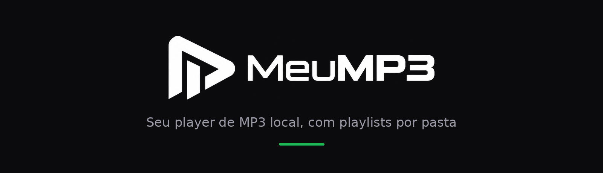
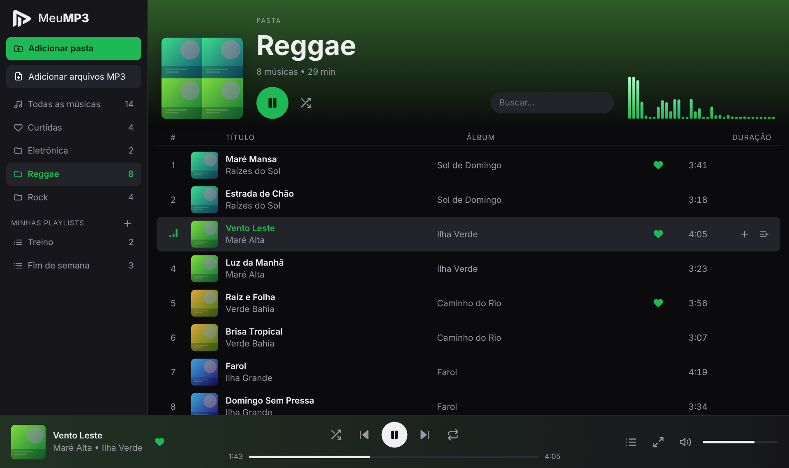
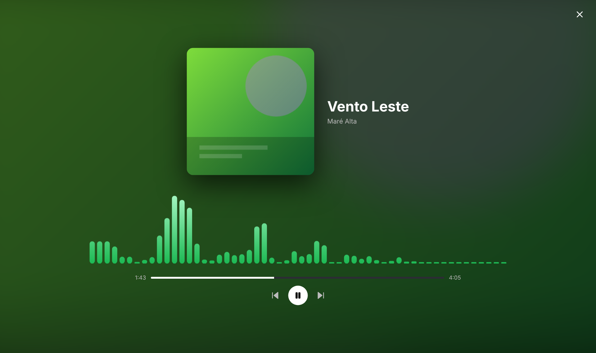
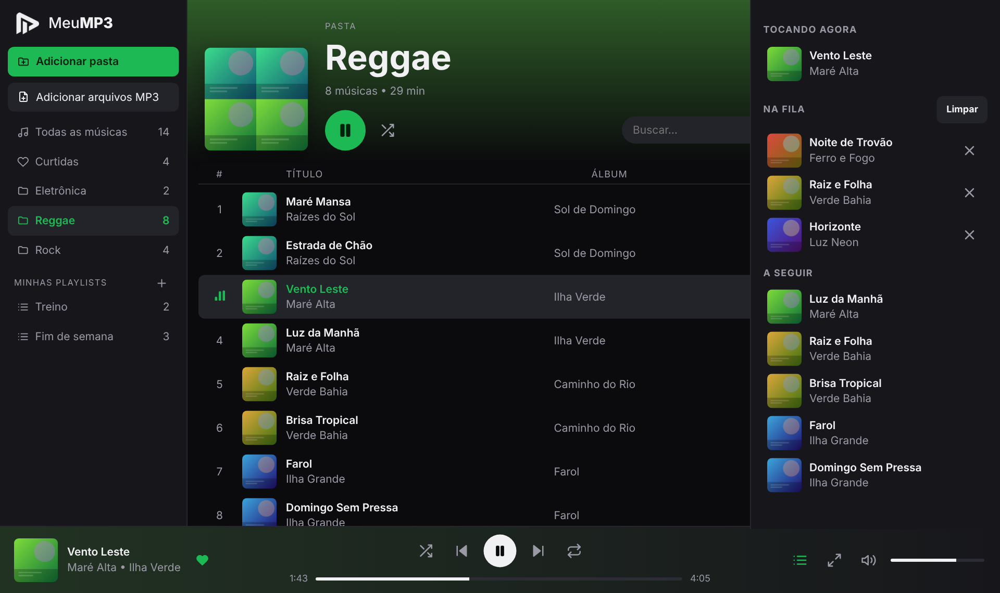
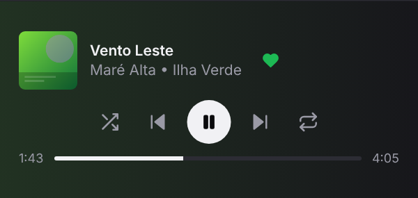

<p align="center">
  
</p>

<p align="center">
  <a href="../../releases"><b>Baixar para Windows</b></a>
  &nbsp;•&nbsp; Sem instalação &nbsp;•&nbsp; Seus arquivos não saem do computador
</p>

<p align="center">
  
</p>

## Destaques

| | |
|---|---|
| **Playlists por pasta** | Arraste suas pastas e cada uma vira uma playlist. |
| **Abre pronto** | Lembra suas pastas e a última música. |
| **Fila e playlists próprias** | Reordene arrastando. Tem também Curtidas. |
| **Tela cheia** | Capa grande e visualizador de áudio. |
| **Mini player** | Janela pequena que fica sempre por cima. |
| **Cores da capa** | A interface acompanha a música que toca. |

<table>
  <tr>
    <td width="50%"><br><sub><b>Tela cheia</b> com visualizador</sub></td>
    <td width="50%"><br><sub><b>Fila</b> de reprodução</sub></td>
  </tr>
</table>

<p align="center">
  <br>
  <sub><b>Mini player</b></sub>
</p>

## Como usar

1. Baixe o `.exe` em [Releases](../../releases) e abra.
2. Arraste suas pastas de MP3 para a janela.
3. Escolha uma playlist e clique em uma música.

> O Windows pode avisar "O Windows protegeu seu computador". Clique em **Mais informações** e depois em **Executar assim mesmo**.

## Atalhos

`Espaço` tocar/pausar &nbsp;•&nbsp; `←` `→` ±5 s &nbsp;•&nbsp; `Shift`+`←` `→` faixa anterior/próxima &nbsp;•&nbsp; `↑` `↓` volume &nbsp;•&nbsp; `F` tela cheia &nbsp;•&nbsp; `Ctrl`+`A` selecionar tudo

## Gerar o executável

Requer [Node.js](https://nodejs.org) (LTS). No Windows, dê dois cliques em `gerar-executavel.bat`, ou use o terminal:

```bash
npm install
npm start       # testar
npm run dist    # gerar o .exe em dist/
```

## Observações

- O `.exe` é só para Windows.
- No navegador não dá para lembrar as pastas. Playlists e curtidas continuam salvas.
- Toca apenas arquivos locais, sem catálogo online.

<sub>Feito com HTML, CSS e JavaScript, empacotado com Electron.</sub>
